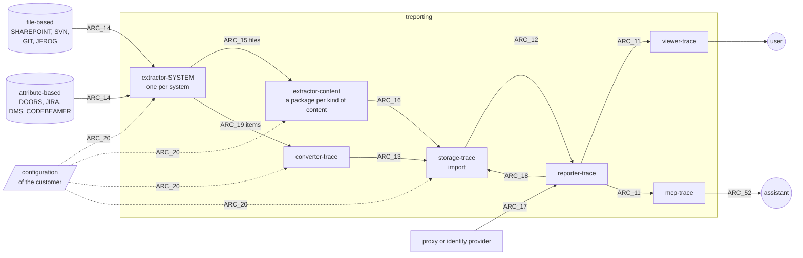

# System architecture (r3)

The subsystems of treporting, their interfaces, and which subsystems realize each system
requirement (r2).

**Figure overview** - the subsystems of treporting and their interfaces



**Table subsystems** - the subsystems and their ids

| Subsystem | Id |
|---|---|
| viewer-trace | ARC_1 |
| reporter-trace | ARC_2 |
| storage-trace | ARC_3 |
| converter-trace | ARC_4 |
| extractor-content | ARC_5 |
| extractor-SYSTEM | ARC_6 |
| mcp-trace | ARC_51 |

There are two kinds of system:

- **file-based** systems - SHAREPOINT, SVN, GIT, JFROG - only manage files: the content lies in
  the folders and files themselves. extractor-content reads it: it takes the files from the
  extractor of the system and hands them to a package for each kind of content, each a plug-in, a
  program of its own that extractor-content starts (ARC_80).
- **attribute-based** systems - DOORS, JIRA, a DMS, CODEBEAMER - hold items whose attributes are
  customized by each customer. The converter maps those attributes to the model, by a
  configuration file of the customer.

Every system has an extractor of its own that lists and fetches what it holds. Converter,
storage and reporter speak one language, the information model (ARC_21), whose contract is
[attributes.md](attributes.md). Our own data in YAML has the schemas of ARC_22 as its contract, in
[schemas/](https://github.com/treporting/specs-and-deploy-process/tree/main/schemas); each schema names it as `@refines ARC_22`, and is a draft of the gel schema. Both ways end in
the import of the storage, which works the same for every system. A subsystem is either a folder
of a code repo, `treporting/<repo>/<subsystem>`, or a repo of its own, `treporting/<subsystem>`;
the field `repo` of its element says which. The folder of a subsystem in a code repo is its name
without the name of the repo: storage-trace in `trace/storage`. Each product has its own
subsystems, a storage too: later storage-tests in `tests/storage`.

**Decision**: what is delivered on its own and talks to others over an interface is a subsystem, an
element of this architecture. What only divides a task within a subsystem is a component. viewer,
reporter, storage and converter are subsystems, with interfaces between them, such as ARC_11 from
the viewer to the reporter; trace is the code repo that holds them, not an element. trace and
maturity in the viewer, objectcode and baseline in tools are components. The next part is classified
by this rule.

**Why**: an interface between parts delivered on their own is set here, in r3, so each side
can be built and tested against it. Within a subsystem nothing is delivered apart, so a
division there needs no interface of r3.

**Rejected**: trace as the subsystem, with viewer, reporter and converter as its components -
they are delivered on their own and talk over interfaces, which a component has not.
The allocation is in this file: the system requirements allocated to a subsystem are
its requirements, derived directly from r2, with no ids of their own. The requirements of the
architecture on a subsystem or an interface stand beside them, with ids of their own. The document is written
for whoever derives the software requirements of a subsystem (r5) from it.

The terms - system, item, content, work product, release, library, baseline - are those of
[definitions.md](https://github.com/treporting/specs-and-deploy-process/blob/main/definitions.md). The levels follow ISO/IEC/IEEE 12207 as set out in the section
Process of [harness.md](https://github.com/treporting/specs-and-deploy-process/blob/main/harness.md); this file is r3, the architecture definition of
ISO/IEC/IEEE 12207, 6.4.4.

The ids are `ARC_n` for the subsystems, the interfaces and the requirements of the architecture on
them, `ARCR_n` for the rationale and
`ARCD_n` for the decisions; a requirement that a decision made possible names it as its
uplink. The elements, the requirements, the allocation and the ids of rationale and decisions are in
[system-architecture.yaml](system-architecture.yaml), in the format of [formats.md](https://github.com/treporting/specs-and-deploy-process/blob/main/formats.md).

## Interfaces

Each interface between two subsystems, with what passes over it. Its requirements are in
[system-architecture.yaml](system-architecture.yaml).

### ARC_11 REST API (viewer-trace, mcp-trace → reporter-trace)

The viewer and the MCP server ask the reporter over a REST API. The technical form is the swagger of the reporter;
this section says what goes across it. Every request names its scope (ARC_29) and may name the
process reference model (ARC_30); a request that names no release is answered from the newest
release and the newest library it delivered (ARC_56). The routes on the trace and the states narrow the rows (ARC_31),
by level (ARC_32) and, on the code, by component and unit (ARC_33). Every answer comes as JSON or
CSV (ARC_36); a request that cannot be answered is refused with the reason (ARC_37).

**Table routes** - the routes of the reporter, what each answers, and what a request carries
beyond the scope

| Route | Answers | Parameters beyond the scope | Asked by the viewer |
|---|---|---|---|
| GET /version | the revision and the build of the reporter, the state of its data set and the number of its objects | - | yes |
| GET /health | that the reporter runs: 200, "ok" | - | no - for the operation |
| PUT /configuration | the lists the filters offer for a scope, from the filter sent; release `*` names the newest release (ARC_56) | filter (body) | yes |
| GET /configuration/projects | the projects of an organization and how they are split | - (organization only) | yes |
| GET /configuration/baselines | the releases and libraries of a project | - (organization, project only) | yes |
| GET /configuration/artefacts | every work product of a subsystem, with its revision, kind, tool and baseline | process; no baseline | yes |
| GET /configuration/systems | the stores and what each holds | process (organization only) | yes |
| GET /configuration/functions | the functions of a scope | level, process | yes |
| GET /configuration/features | the features of a scope | level, process | yes |
| GET /configuration/safety | the safety classes of a scope | - | yes |
| GET /configuration/components | the components of the code and their units; release `*` names every release | - (no library) | yes |
| GET /maturity/requirements | the trace from a level, one row per object | level, narrowing, component, unit, process, above, keys | yes |
| GET /requirements/features | the trace from a feature | narrowing | yes |
| GET /maturity/features | the maturity per feature | level, narrowing, process | yes |
| GET /maturity/states | the counted states of a level over the libraries | level, narrowing, component, unit, process; no baseline | yes |
| GET /maturity/components | the components and the state of their requirements or tests | level, process | yes |
| GET /maturity/compliance | per clause of a standard what addresses it and its state | process | yes |
| GET /maturity/compliance/states | per release how many clauses are open, addressed and verified | process; no release | yes |

The levels above each row come only on request (ARC_34), so that a view of a large data set stays
within its time (SYS_52). A cell comes as the keys of its objects or as the count per state
(ARC_35): one table serves the single object of the trace (SYS_1) and the count of the states
(SYS_5).

### ARC_12 StorageSource (reporter-trace → storage-trace)

The reporter reads the data sets of the storage through `StorageSource`, a Go interface of the
storage. Behind it, the storage holds the data in one of four modes of operation: in a database
server of its own (ARC_23), in a database run together with the reporter (ARC_24), in a data file
(ARC_25), or as generated data in the memory of the reporter (ARC_26). The reporter answers the
same from each (ARC_27), and from one mode only while it runs (ARC_28).

The storage hands the reporter the data of a scope; what a route makes of them - the states, the
counting, the trace - is the reporter's, the same for every mode.

**Table source** - what goes from the storage to the reporter, and what it is needed for

| What goes across | Needed for | SYS |
|---|---|---|
| the names of every scope: organizations, requirements projects and their subsystems, releases, libraries (ARC_38) | the lists to choose from; refusing a scope that does not exist | SYS_9, SYS_20 |
| each baseline with its project, start and end; for a library the release it went into (ARC_39) | the baselines over time, the libraries in their order | SYS_17 |
| every object with its scope, its key, its level by key and its state, as read and mapped (ARC_40) | the answer from one scope; the states and their counts | SYS_1, SYS_5, SYS_8, SYS_20 |
| the links downward, each object once however many link to it (ARC_41) | the trace down, the missing places | SYS_1, SYS_2, SYS_6, SYS_12, SYS_13 |
| test cases, test procedures and test results as kinds apart (ARC_42) | their states apart | SYS_8 |
| on every level function, feature, priority, safety class, platform, launch and stream; the mapped value of priority and of platform and launch (ARC_43) | narrowing | SYS_9, SYS_11 |
| per requirement its verification method, and per level whether it is verified (ARC_44) | a missing test case | SYS_2, SYS_73 |
| per object its component and unit, and the components with their units (ARC_45) | narrowing the code | SYS_1 |
| per requirements project its head: the levels in order, with key, name and views (ARC_46) | the levels of the trace | SYS_14, SYS_49 |
| the work products with baseline, revision, level, kind and store, and the stores with their work products (ARC_47) | the work products of a baseline | SYS_15 |
| the name of the data set | the data set on every view | SYS_18 |
| per baseline the version of code and test procedures, and what changed | the changes of a baseline | SYS_16 |
| the code coverage level sc1, as a level | the chain of maturity | SYS_49 |
| a failed read apart from a read with no data, with the error (ARC_48) | the refusal with the reason | SYS_29, SYS_37, SYS_38 |
| that the data set is still being filled (ARC_49) | refusing while the data are not there | SYS_34, SYS_54 |

### ARC_14 system access (extractor-SYSTEM → system)

The extractor of a system reaches the system per system: it lists the baselines the system holds -
for a file-based system its tags and branches (ARC_57) - and lists and fetches what a baseline
holds, with its identity in the system (ARC_58). It counts what a baseline holds by a query of its
own, apart from the listing and fetching (ARC_59); a system with no count of its own, as GitHub
over its REST API, does not meet it, and its data set is then unverified (ARCD_2). It never writes
into the system (ARC_60, ARCR_1), and says a system it cannot reach, or a fetch that fails, with
the cause (ARC_61).

### ARC_15 files (extractor-SYSTEM → extractor-content)

The extractor of a file-based system hands extractor-content the files of a baseline: first the
baseline, its name and its date (ARC_62), then each file with its path, its content, its kind and
its identity in the system (ARC_63), and at the end that the files are all handed over, so that
what spans several files - a link - is made after the last (ARC_64). The release a library is
delivered into is not handed over here; it is in the configuration (ARC_20).

### ARC_16 information (extractor-content → storage)

extractor-content hands the storage, over ARC_13, what it read from the files: the objects (ARC_65),
the links, also where an end is missing (ARC_66), the files as work products (ARC_67), and per work
product its reviews and the findings of the customer (ARC_68). Every value goes across as the file
holds it, derived from nothing (ARC_69). What it could not read is named with the reason (ARC_70);
what it read and refused is counted per kind, per type of link and per state (ARC_71); its errors
and warnings go across with time and cause (ARC_72).

### ARC_13 import (converter, extractor-content → storage)

The storage takes the information of every system the same way, into the model of ARC_21 (ARC_73),
and builds from the same information the same data set on every import (ARC_74). After the import
it counts what it stored, apart from the counts handed in (ARC_75); until the import is done the
data set is marked as being filled (ARC_76). A data set of size large is imported, with the checks
of Integrity, within the time given (ARC_77). This section holds the part of extractor-content; the
part of the converter is not written yet.

### ARC_20 configuration (customer → extractor-SYSTEM, extractor-content, converter, storage)

The configuration of the customer is used on both ways into the storage. Each of the four uses it
for what it does itself: the extractor-SYSTEM in reading the system, extractor-content and the
converter in mapping, the storage in deriving the values. The way of the file-based systems maps
too: that our own YAML matches the model is chance. The configuration is taken from a file, from
the command line and from the environment (ARC_78, ARCD_6), and it names per release the libraries
it delivers (ARC_79).

**Figure ways** - the two ways the data come into the storage

```
way 1 - file-based (SHAREPOINT, SVN, GIT, JFROG)

  system ──ARC_14──▶ extractor-SYSTEM ──ARC_15──▶ extractor-content ──ARC_16──▶ storage (import)
                          ▲                             ▲                          ▲
  customer ──▶ config ────┴────────────ARC_20───────────┴──────────────────────────┘


way 2 - attribute-based (DOORS, JIRA, DMS, CODEBEAMER)

  system ──ARC_14──▶ extractor-SYSTEM ──ARC_19──▶ converter ──ARC_13──▶ storage (import)
                          ▲                          ▲                     ▲
  customer ──▶ config ────┴────────────ARC_20────────┴─────────────────────┘
```

### ARC_52 Model Context Protocol (assistant → mcp-trace)

An assistant asks the MCP server over the Model Context Protocol. The server offers one tool per
view of the viewer (ARC_53); each tool asks the reporter over the REST API (ARC_11) and answers its figures
as the view shows them (SYS_99), with the view and the filters that show the same (SYS_100).
An answer carries at most as many rows as the assistant names, 100 where it names none, and says
how many rows it left out (ARC_54).
The server answers from the one organization it is started with and never asks the assistant
for it (ARC_55).

## Rationale

The principles every decision below follows.

### ARCR_1 Read only

treporting only reads the data of its users. It never writes into a source system
and never holds data that a user enters into treporting itself. What it writes are records of
its own: the data set as read, the derived values beside it, the import records, the record of
every report and the audit trail.

**Example**: a finding of the plausibility analysis is evaluated where the customer works - an
attribute in DOORS, a ticket in JIRA linked to the requirement -, and treporting reads that
evaluation like any other data. The approval of a release is made where the organization makes
it, and names the report it relied on.

**Why**: we do not know how others work, so treporting fits into what is there instead of
prescribing a way of working. What a user decides stays in the system where it is evidence
without treporting. And treporting needs no input of its own - no rights to enter data, no
audit trail of entries, no second place where the truth could be.

**What it rules out**: evaluating findings or approving releases in treporting - it would leave
the maxim, and bring a way of working, an audit trail of entries and a second truth with it.

## Decisions

### ARCD_1 Independent count (SYS_23)

**Decision**: the source system is counted by a query of its own (ARC_14), in the extractor of the system
but in code apart from the reader, and the stored count is taken from the storage after the import. A reader never
reports what it read as the count of the source system. Besides, a verifier of its own, apart from all
subsystems, checks the data of treporting itself (the reference edgedb) and is run on request,
for instance by an assessor; it is not delivered with the product.

**Example**: a CODEBEAMER tracker holds 1 200 requirements, read in pages of 500. A fault in the
paging drops the last page, so 1 000 are read. A reader that counts what it reads reports
1 000 in the source system, 1 000 read, 1 000 stored - all equal, and wrong. The query of its own asks
for the total and gets 1 200; the difference of 200 marks the data set incomplete. On the other
side, two requirements share an id in the source system: 1 200 are read, the second overwrites the first,
and only a count taken from the storage afterwards shows 1 199. In code, an `@implements` written
over two lines is missed by the reader and found by a plain `git grep -c '@implements'`.

**Why**: a count made by the reader shares every error of the reading, so it cannot find one. Only
a count on another way detects the errors of an import with high confidence - which is what tool
error detection TD1 asks for, and what keeps treporting at TCL1 without qualification (see
Integrity in the system requirements). The verifier goes one step further, independent of the
whole product; it costs a repo of its own, so it is kept for the own data and for the cases where
an assessor asks for it, rather than run on every import.

**Rejected**: the reader counting for itself - cheap, but it misses exactly the faults above.

### ARCD_2 Import record (SYS_26, SYS_41)

**Decision**: the import of the storage brings the four counts together - the count of the
source system from the extractor of the system, read and refused from extractor-content or
the converter, stored from the storage itself -, so it sets the state
of the data set - complete, incomplete, or unverified when the source system has no count of its own - and
keeps the import record. The storage keeps the record with the data set,
the reporter hands the state on with every answer, the viewer shows it on every view.

**Example**:

```
import 2026-10-23T14:02:11Z  by m.fischer
  source system codebeamer, tracker 4711, revision 3812
  converter     converter-trace v1.4.0, configuration acme-codebeamer v7
  data set      release-2.1
  counted       requirement: source system 1200, read 1000, refused 0, stored 1000
                link parentOf: source system 3400, read 2890, refused 0, stored 2890
  refused       -
  fingerprints  1000 compared, 0 differ
  state         incomplete  (requirement -200, link parentOf -510)
```

**Why**: the record carries the trace of a report past the data set to the source system and its
revision (REG_FDADI_1), it is the audit trail of a change of data (REG_CFR21-11_1), and it is the evidence that
errors of an import are detected (REG_ISO26262-8_1, REG_IEC61508-3_1, REG_DO178C_1, REG_DO330_1).

### ARCD_3 Original and derived values (SYS_11)

**Decision**: the storage always keeps the original as read from the source system. A value derived at
the import is never the original and is kept beside it under a name of its own, with a
prefix: `M` for a value mapped - unified, translated or adapted to the model; where the original
is empty, the mapped value of the parent -, `I` for an intermediate form, only for the status, where
the original has to be transformed before it can be mapped. When a rule changes, the derived values can be made again on the stored data set,
back in time, so that the data need not be fetched from the source systems again - a requirement
that follows from this architecture, not from a need (ARC_50).

**Example**: the source system says `Status = 'im Review'`; the import keeps it and adds
`MStatus = 'review'`, as the configuration of the customer maps it. A status kept per platform -
`Status = "status_platform-1 = in Review_Vendor` / `status_platform-2 = open"` - is first transformed
into `IStatus = "platform-1 = in Review` / `platform-2 = open"`; `MStatus` is then `review` when the
filter selects platform-1, made for the filter set where it is not stored. A software requirement
without a safety class under parents of ASIL B and QM keeps `Safety` empty and gets
`MSafety = 'ASIL B'`; its test case and test result get `MSafety = 'ASIL B'` as well.

**Why**: what is stored can be compared with the source system (SYS_25) and stays original (REG_FDADI_1).
Where the evidence is that every requirement was classified by a person, the report shows
`Safety`, not `MSafety`; where the evidence is that nothing falls out of a filter, it shows
`MSafety`. A change of a rule needs no new import. Only a derived value that is stored can be
checked for plausibility - the reporter finds an original `Safety = 'QM'` under a parent
with `MSafety = 'ASIL D'` in its analysis (SYS_70); the import reads the data as it is.

**Rejected**:

- the reporter derives the values when it answers, and nothing derived is stored. It keeps the
  rule in one place and the storage plain, but a derived value then exists only in an answer:
  it cannot be checked for plausibility, compared between two reports, or shown to an auditor
  as what the report was made from.
- the storage derives them in a view of the database. It binds the rule to the database, and the
  data file (SYS_21) would need the rule a second time.

### ARCD_4 Configuration instead of code for the customer (SYS_22)

**Decision**: what differs from customer to customer - the customized attributes of an
attribute-based system and the values to be mapped - is a configuration file, read by one
general mechanism: the converter for the attributes, the import of the storage for the
values. Only what a configuration cannot say goes into code of its own, in a private repo per
system and customer, such as converter-doors-acme.

**Example**: one customer keeps the safety class of a requirement in the DOORS attribute
`ASIL_Rating`, another in `Safety Level`, with the values `QM, A, B, C, D` or `none, ASIL A, ...`.
Two configuration files map both to `Safety` and their values to `MSafety`; the code is the same.

**Why**: the formats of a customer are proprietary and must not reach the public repos. A
configuration stays with the customer; the mechanism stays public and is tested once for all.

**Rejected**: a converter in code per system - the proprietary formats would be in code, and the
same mechanics would be written once per system.

### ARCD_5 Identity (SYS_39)

**Decision**: treporting keeps no users and no passwords of its own. It takes the identity from
what the organization already has: preferably from a proxy in front of it that authenticates the
user and hands the identity and the groups on - transparent, treporting needs no logic of its
own for it -, and where possible from the identity provider of the organization over a standard
protocol (OIDC). The organization maps its groups to the roles of treporting by configuration.

**Example**: a supplier runs treporting in its own network; its people log in everywhere with
their company account. When someone leaves, the one account is locked, and treporting is closed
to them at the same moment - there is nothing to lock in treporting.

**Why**: we do not know how others manage their users, so treporting fits into what is there
instead of bringing a second management. A proxy keeps that entirely outside treporting.

**Rejected**: a user management of its own in treporting - a second place to lock an account,
and the duty of keeping passwords.

### ARCD_6 Sources of the configuration

**Decision**: the configuration is taken from a file, from the command line and from the
environment, each part from any of them; the operator manual says which way is preferred for
which part.

**Example**: the organization, the projects with their repositories and the libraries of each
release stand in one file, the same for every run; the repository and the tag of one run are
given on the command line; the token of the system is given in the environment.

**Why**: in practice no single way serves every part: what holds for many runs belongs in a
file, what changes with each run on the command line, and a secret is best kept out of both,
where a file is kept in a repository and a command line is shown by `ps`.

**Rejected**: one way only - a file alone has to be written again for every run, a command line
alone repeats the same settings in every run and shows a secret.

## Allocation

The allocation of every system requirement to the subsystems, and of every requirement of the
architecture to the subsystems and interfaces, is the field `allocated` of each of them in
[system-architecture.yaml](system-architecture.yaml).

## Open

- `treporting = 4_selfhosted` - **Licensed features**: not decided where their source lives and how
  the licence of an installation is proved. None exists yet. They would be in the product, checked
  per route - role, rights, licence -, under the Elastic License 2.0, in a directory of their own
  per repo.
- `treporting = 1_demo` - **Repos**: the repos of extractor-content and of the extractors per system
  are not created yet. reporter-annotations becomes the package annotations of extractor-content.

- `treporting = 1_demo` - **Interfaces**: the sections of ARC_17 to ARC_19 are not written yet;
  of ARC_13 only the part of extractor-content.
  ARC_11 describes the routes there are; no route answers yet the findings of the plausibility
  check (SYS_71), the states of the code (SYS_77), a report of the views chosen (SYS_85), or the
  record of what users did (SYS_90).
  ARC_12 describes what goes across there; not yet: the objects above each object (SYS_1) - the
  storage keeps every link from both ends, or hands the downward links whole and the reporter turns
  them round; the mapped value of function, feature and safety class (SYS_11); an unknown value apart
  from an empty one (SYS_28); the process reference model a data set names (SYS_14); the revision
  and the state of the data set (SYS_18, SYS_26); the reviews and approvals of a work product
  (SYS_74, SYS_75); the import records and the audit trail (SYS_32, SYS_41); that no read changes
  the data set (SYS_19); the time of a read of a data set of size large (SYS_52).

## Change history

| Version | Date | Change | Reason | By |
|---|---|---|---|---|
| 1.1.1 | 2026-10-30 | - | #327 | Claude Opus 5.5 and Mathias Fischer, authors; Mathias Fischer, reviewer |
| 2.1.1 | 2026-10-30 | System architecture; Decisions | #334 | Claude Opus 5.5, author; Mathias Fischer, reviewer |
| 3.1.1 | 2026-11-12 | Links to specs-and-deploy, from the repo of its own | specs-and-deploy#640 | Claude Opus 5.5, author; Mathias Fischer, reviewer |
| 4.1.1 | 2026-11-13 | specs-and-deploy is named specs-and-deploy-process | specs-and-deploy-process#641 | Claude Opus 5.5, author; Mathias Fischer, reviewer |
| 5.1.1 | 2026-11-13 | The allocation: r4 gone | treporting/specs-and-deploy-process#653 | Claude Opus 5.5, author; Mathias Fischer, reviewer |
| 6.1.1 | 2026-11-17 | Keys without a leading zero | specs-and-deploy-process#679 | Claude Opus 5.5, author; Mathias Fischer, reviewer |
| 7.1.1 | 2026-11-18 | A subsystem is a folder of a code repo or a repo of its own | #26 | Claude Opus 5.5, author; Mathias Fischer, reviewer |
| 8.1.1 | 2026-11-19 | Where a subsystem lives is the field repo of its element; Table subsystems: no short forms | #28 | Claude Opus 5.5, author; Mathias Fischer, reviewer |
| 9.1.1 | 2026-11-20 | The rule that tells a subsystem from a component; storage-trace; the folder of a subsystem | #30 | Claude Opus 5.5, author; Mathias Fischer, reviewer |
| 10.1.1 | 2026-11-21 | Source system, not source; the interface StorageSource | #33 | Claude Opus 5.5, author; Mathias Fischer, reviewer |
| 11.1.1 | 2026-11-21 | Requirements of the architecture; the modes of operation; Interfaces, with ARC_12 | #34 | Claude Opus 5.5, author; Mathias Fischer, reviewer |
| 12.1.1 | 2026-11-21 | The interface ARC_11 REST API: its routes and its requirements | #37 | Claude Opus 5.5, author; Mathias Fischer, reviewer |
| 13.1.1 | 2026-11-21 | The interface ARC_12 StorageSource: what goes across and its requirements | #37 | Claude Opus 5.5, author; Mathias Fischer, reviewer |
| 14.1.1 | 2026-11-21 | ARCD_3: the requirement it made possible is ARC_50 | #39 | Claude Opus 5.5, author; Mathias Fischer, reviewer |
| 15.1.1 | 2026-11-21 | The MCP server: the subsystem ARC_51 and its interface ARC_52; ARC_11 serves it too | #45 | Claude Opus 5.5, author; Mathias Fischer, reviewer |
| 16.1.1 | 2026-11-21 | ARC_52: its requirement ARC_53, one tool per view | #60 | Claude Opus 5.5, author; Mathias Fischer, reviewer |
| 17.1.1 | 2026-11-22 | ARC_52: its requirement ARC_54, the limit on the rows of an answer | #62 | Claude Opus 5.5, author; Mathias Fischer, reviewer |
| 18.1.1 | 2026-11-22 | ARC_52: its requirement ARC_55, the organization; ARC_11: its requirement ARC_56, the newest baseline | #64 | Claude Opus 5.5, author; Mathias Fischer, reviewer |
| 19.1.1 | 2026-11-22 | ARC_5: extractor-content is a plug-in that an extractor-system starts | #66 | Claude Opus 5.5, author; Mathias Fischer, reviewer |
| 20.1.1 | 2026-11-22 | The file-based way into the storage: the sections of ARC_14, ARC_15, ARC_16 and ARC_13, and their requirements ARC_57 to ARC_77 | #69 | Claude Opus 5.5, author; Mathias Fischer, reviewer |
| 21.1.1 | 2026-11-22 | ARC_20: the configuration on both ways into the storage, its requirements ARC_78 and ARC_79, and the decision ARCD_6 | #68 | Claude Opus 5.5, author; Mathias Fischer, reviewer |
| 22.1.1 | 2026-11-22 | ARC_5: extractor-content starts its packages as plug-ins | #72 | Claude Opus 5.5, author; Mathias Fischer, reviewer |
| 23.1.1 | 2026-11-22 | ARC_5: its requirement ARC_80, the plug-ins | #74 | Claude Opus 5.5, author; Mathias Fischer, reviewer |
